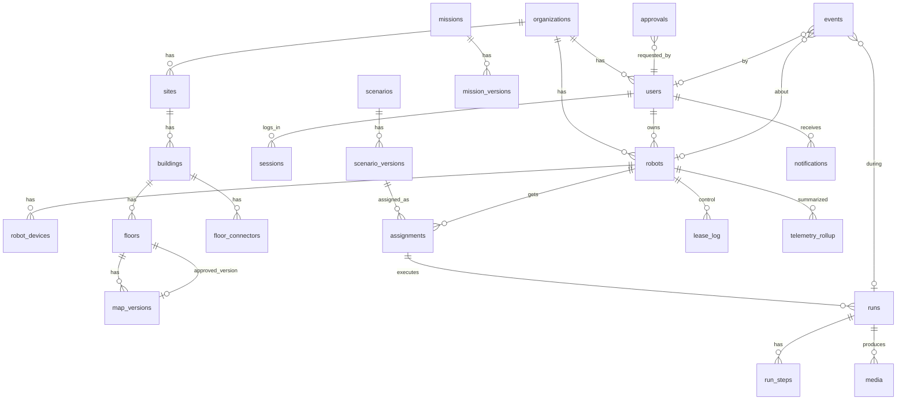

# FOOTHOLD 로봇 운영 플랫폼 — 데이터베이스 설계서

| 항목 | 내용 |
|---|---|
| 문서 번호 | FH-SPEC-06 |
| 판 | 0.1 (초안, 검토 대기) |
| 작성일 | 2026-10-19 |
| DB | PostgreSQL 16 (제안) |
| 상위 문서 | [04 아키텍처](04-ARCHITECTURE.md) · [05 API](05-API-SPEC.md) |

---

## 1. 저장 원칙

| # | 원칙 | 내용 |
|---|---|---|
| D1 | 정본은 서버 DB 하나 | 로봇마다 따로 쌓던 지금 구조(docs.json/SQLite·events.jsonl)를 하나로 모은다 |
| D2 | 판은 고치지 않는다 | 임무·시나리오·지도는 "본체 + 판" 두 테이블. 판 행은 만든 뒤 바꾸지 않는다. 배정·실행·결재는 판을 가리킨다 |
| D3 | 사건은 덧붙이기만 | `events` 는 INSERT 만. UPDATE·DELETE 권한을 앱 계정에서 뺀다 |
| D4 | 큰 파일은 파일 저장소 | 지도 이미지·사진·보고서는 디스크, DB 에는 경로·sha256·크기만 (지금 사진 방식과 같음) |
| D5 | 빠르게 바뀌는 상태는 메모리 | 로봇 현재 위치·속도·조종권 heartbeat 는 서버 메모리. DB 에는 바뀐 사건과 요약만 |
| D6 | 낙관적 잠금 | 편집 자원은 `version` 정수. 저장 때 비교, 다르면 409 (지금 rev·409 규칙 유지) |
| D7 | 지우지 않고 보관 | 사용자·로봇·임무·시나리오는 `archived_at` 으로 숨김. 기록이 가리키는 대상이 사라지지 않게 |

### 1.1 왜 PostgreSQL 인가 (지금 계획은 SQLite)
| 기준 | SQLite (지금) | PostgreSQL (제안) |
|---|---|---|
| 여러 로봇·여러 사람 동시 쓰기 | 쓰기 1개씩(WAL), 원격측정과 결재가 겹치면 대기 | 행 단위 잠금 |
| 결재 승인 같은 "검사 후 쓰기" | `BEGIN IMMEDIATE` 로 전체 잠금 | `SELECT … FOR UPDATE` 로 그 행만 |
| JSON 자료(지도 요소·작업 인자) | 문자열 | JSONB + 색인 |
| 부분 고유 색인(로봇당 실행 1개) | 됨 | 됨 |
| 운영 부담 | 파일 하나 | 서비스 하나 (Docker 로 묶으면 작음) |
| 판단 | 1대·1인 시연에 적합 | **조직 단위 다중 로봇에 적합** |

SQLite 저장소(server/store.py, 시험 13개)는 규칙(STRICT·부분 고유 색인·rev 충돌)을 옮기는 참고로만 쓰고, 두 DB 를 같이 지원하지 않는다. (제안)

---

## 2. 관계도



---

## 3. 테이블

자료형 약속: `id uuid PK default gen_random_uuid()`, 시각 `timestamptz`, 모든 테이블에 `org_id uuid NOT NULL` (조직 분리. 아래 표에서는 생략).

### 3.1 조직·사람

**organizations**
| 열 | 형 | 설명 |
|---|---|---|
| id | uuid PK | |
| name | text | |
| settings | jsonb | 기준값: `battery_low_pct`(20), `run_min_battery_pct`(30), `deviation_m`(1.5), `lease_request_timeout_s`(10), `link_loss_wait_s`(30) |
| created_at | timestamptz | |

**users**
| 열 | 형 | 설명 |
|---|---|---|
| id | uuid PK | |
| username | text | 조직 안에서 고유 (`UNIQUE(org_id, lower(username))`) |
| display_name | text | |
| role | text | `ORG_ADMIN` / `OPERATOR` (CHECK) |
| password_hash | text | scrypt (n=2^14, r=8, p=1 — 지금과 같음) |
| locked | bool | |
| notify_prefs | jsonb | 알림 종류별 켜기/끄기 |
| created_at, archived_at | timestamptz | |

**sessions**
| 열 | 형 | 설명 |
|---|---|---|
| id | uuid PK | |
| user_id | uuid FK | |
| token_hash | bytea | 세션/리프레시 토큰 sha256 (원문 저장 안 함) |
| client | text | `web` / `app` |
| device_label | text | "이OO 폰" |
| created_at, last_seen_at, expires_at, revoked_at | timestamptz | |

지금은 세션이 게이트 메모리에만 있어 재시작하면 모두 로그아웃된다 → DB 로 옮긴다.

### 3.2 로봇

**robots**
| 열 | 형 | 설명 |
|---|---|---|
| id | uuid PK | |
| name | text | `UNIQUE(org_id, name)` |
| model | text | `unitree_go2` 등 |
| owner_user_id | uuid FK NULL | 담당 운영 관리자 1명 (PRD Q4) |
| agent_token_hash | bytea | 에이전트 토큰 sha256 |
| last_floor_id | uuid FK NULL | 마지막 확인 층 |
| last_floor_source | text | `HUMAN` / `AUTO` |
| last_seen_at | timestamptz | |
| created_at, archived_at | timestamptz | |

**robot_devices** (에이전트 `hello` 로 갱신)
| 열 | 형 | 설명 |
|---|---|---|
| robot_id | uuid FK | |
| key | text | `rgb`, `depth`, `lidar`, … PK(robot_id, key) |
| kind | text | `CAMERA_RGB`, `CAMERA_DEPTH`, `LIDAR`, `BATTERY`, `OTHER` |
| label | text | |
| state | text | `OK` / `MISSING` / `ERROR` |
| info | jsonb | 모델명·펌웨어 등 |
| updated_at | timestamptz | |

### 3.3 장소·지도

**sites / buildings / floors**
| 테이블 | 주요 열 |
|---|---|
| sites | id, name |
| buildings | id, site_id FK, name |
| floors | id, building_id FK, name("2층"), level(int, 정렬·층 그래프용), approved_map_version_id FK NULL |

**map_versions** (고치지 않음)
| 열 | 형 | 설명 |
|---|---|---|
| id | uuid PK | |
| floor_id | uuid FK | |
| number | int | 층 안 판 번호 `UNIQUE(floor_id, number)` |
| base_version_id | uuid FK NULL | 어느 판을 고쳤는지 |
| status | text | `PENDING` / `APPROVED` / `REJECTED` / `SUPERSEDED` |
| image_path | text | 파일 저장소 경로 |
| image_sha256 | bytea | |
| resolution, origin_x, origin_y, origin_yaw | float8 | map.yaml 값 |
| features | jsonb | 구역·지점·연결점·편집 ([05 §5](05-API-SPEC.md#5-지도)) |
| source | text | `SLAM` / `EDIT` / `ROLLBACK` / `IMPORT` |
| created_by | uuid FK | |
| created_at | timestamptz | |

- 승인되면 `floors.approved_map_version_id` 를 바꾸고 이전 승인 판은 `SUPERSEDED`. 한 트랜잭션.

**floor_connectors**
| 열 | 형 | 설명 |
|---|---|---|
| id | uuid PK | |
| building_id | uuid FK | |
| kind | text | `STAIRS` / `ELEVATOR`(향후) |
| floor_a_id, floor_b_id | uuid FK | |
| a_pose, b_pose | jsonb | `{x, y, yaw}` 각 층 좌표 |
| map_version_a_id, map_version_b_id | uuid FK | 이 연결점이 정의된 판 |
| active | bool | |

### 3.4 임무·시나리오

**missions / mission_versions**
| 테이블 | 주요 열 |
|---|---|
| missions | id, name, created_by, latest_version(int), version(낙관적 잠금), created_at, archived_at |
| mission_versions | id, mission_id FK, number, steps jsonb `[{action, params}]`, required_devices text[], created_by, created_at · `UNIQUE(mission_id, number)` |

**scenarios / scenario_versions**
| 테이블 | 주요 열 |
|---|---|
| scenarios | id, name, created_by, latest_version, version, created_at, archived_at |
| scenario_versions | id, scenario_id FK, number, waypoints jsonb, finish jsonb, floor_ids uuid[], map_version_ids uuid[], required_devices text[], est_distance_m float8, created_by, created_at · `UNIQUE(scenario_id, number)` |

- `waypoints` 안의 `mission_id + mission_version` 은 판을 고정해서 가리킨다.
- `map_version_ids` 는 실행 전 점검의 "지도 판이 지금 승인 판과 같은가" 비교에 쓴다.

### 3.5 배정·실행

**assignments**
| 열 | 형 | 설명 |
|---|---|---|
| id | uuid PK | |
| scenario_version_id | uuid FK | |
| robot_id | uuid FK | |
| status | text | `PENDING` / `ACTIVE` / `REJECTED` / `REMOVED` |
| approval_id | uuid FK NULL | 운영자 요청이면 결재 |
| memo | text | |
| created_by, created_at, removed_at | | |

**runs**
| 열 | 형 | 설명 |
|---|---|---|
| id | uuid PK | |
| assignment_id | uuid FK | |
| robot_id | uuid FK | (조회용 중복) |
| scenario_version_id | uuid FK | (조회용 중복) |
| status | text | `QUEUED` `PREPARING` `MOVING` `AT_WAYPOINT` `PERFORMING` `PAUSED` `WAIT_CONFIRM` `COMPLETED` `FAILED` `ABORTED` |
| emergency | bool | 긴급 실행 |
| emergency_reason | text NULL | |
| fail_code | text NULL | `NAV_TIMEOUT` 등 |
| fail_message | text NULL | 한 줄 문장 |
| plan | jsonb | 서버가 만든 층 구간 계획 |
| path_actual | jsonb NULL | 끝난 뒤 1 Hz 로 줄인 실제 경로 |
| started_by | uuid FK | |
| started_at, ended_at | timestamptz | |

- **로봇당 진행 중 실행 1개**: `CREATE UNIQUE INDEX one_active_run ON runs(robot_id) WHERE status NOT IN ('COMPLETED','FAILED','ABORTED');` (지금 SQLite 의 같은 이름 색인을 옮김)

**run_steps**
| 열 | 형 | 설명 |
|---|---|---|
| run_id | uuid FK | PK(run_id, idx) |
| idx | int | 지점 순번 |
| status | text | `PENDING` `ARRIVED` `DONE` `SKIPPED` `FAILED` |
| arrived_at, done_at | timestamptz | |
| results | jsonb | 작업별 결과(운영자 확인 답, 센서 값 요약) |

**media**
| 열 | 형 | 설명 |
|---|---|---|
| id | uuid PK | |
| kind | text | `PHOTO` / `REPORT` / `MAP_IMAGE` |
| path | text | 파일 저장소 상대 경로 |
| sha256 | bytea | |
| bytes | int | |
| robot_id, run_id, step_idx | NULL 허용 | |
| taken_by | uuid NULL | |
| label | text NULL | 분류(확인·보류·제외) |
| memo | text NULL | |
| created_at | timestamptz | |

### 3.6 결재

**approvals**
| 열 | 형 | 설명 |
|---|---|---|
| id | uuid PK | |
| kind | text | `MAP_REVISION` `MAP_ROLLBACK` `SCENARIO_ASSIGNMENT` `POST_REVIEW` |
| status | text | `PENDING` `APPROVED` `REJECTED` `CANCELED` `STALE` / 사후 확인은 `OPEN` `ACKNOWLEDGED` `FLAGGED` |
| target_type | text | `map_version` / `assignment` / `run` |
| target_id | uuid | |
| base_ref_type, base_ref_id | NULL 허용 | 요청 당시 기준(예: 승인 판). 승인 때 비교해 다르면 `STALE` |
| requester_id | uuid FK NULL | 시스템 생성이면 NULL |
| reason | text | 요청 이유(지도 수정은 필수) |
| decider_id | uuid FK NULL | |
| decision_comment | text NULL | 반려는 필수 (CHECK) |
| emergency | bool | |
| created_at, decided_at | timestamptz | |

- 색인: `(org_id, status, created_at)`, `(requester_id, status)`.
- 같은 대상에 대기 결재 1개: `UNIQUE(target_type, target_id) WHERE status = 'PENDING'`.
- 승인 처리: `SELECT … FOR UPDATE` 로 결재 행과 대상 층(또는 배정) 행을 잠근 뒤 기준 비교 → 반영 → `events` 기록을 한 트랜잭션에서.

### 3.7 조종권 기록

**lease_log** (조종권 바뀜·요청의 감사용. 현재 조종권 자체는 서버 메모리)
| 열 | 형 | 설명 |
|---|---|---|
| id | bigserial PK | |
| robot_id | uuid FK | |
| op | text | `TAKE` `RELEASE` `REQUEST` `ACCEPT` `DECLINE` `TIMEOUT` `EXPIRE` `RUN_TAKE` `RUN_PAUSE_TAKEOVER` |
| user_id | uuid NULL | |
| other_user_id | uuid NULL | 요청자/받은 사람 |
| session_id | uuid NULL | |
| at | timestamptz | |

서버가 재시작되면 메모리 조종권은 모두 사라지고, 로봇 에이전트도 잠금 상태가 된다(안전 쪽으로 실패).

### 3.8 사건·알림·원격측정

**events** (덧붙이기만)
| 열 | 형 | 설명 |
|---|---|---|
| id | bigserial PK | |
| at | timestamptz | 서버 시각 |
| robot_at | timestamptz NULL | 로봇 시각(끊김 중 쌓인 사건) |
| category | text | `RUN` `ROUTE` `LINK` `LEASE` `APPROVAL` `SAFETY` `ACCOUNT` |
| code | text | `ROUTE_DEVIATION` 등 |
| severity | text | `INFO` `WARN` `ERROR` |
| message | text | 저장 때 만든 한국어 문장 ([02 F-LG-02](02-FUNCTIONAL-SPEC.md#f-lg-02-문장-틀-예)) |
| robot_id, user_id, run_id, approval_id | NULL 허용 | |
| data | jsonb | 원값 |

- 색인: `(org_id, at DESC)`, `(robot_id, at DESC)`, `(run_id, at)`, `(category, at DESC)`.
- 문장 틀이 나중에 바뀌어도 옛 사건 문장은 그대로(그때 보인 문장이 기록).

**notifications**
| 열 | 형 | 설명 |
|---|---|---|
| id | bigserial PK | |
| user_id | uuid FK | |
| event_id | bigint FK NULL | |
| kind | text | `APPROVAL_REQUESTED` `APPROVAL_DECIDED` `LEASE_REQUESTED` `RUN_FAILED` … |
| title, body | text | |
| link | text | 화면 경로 |
| read_at | timestamptz NULL | |
| created_at | timestamptz | |

**push_subscriptions**: user_id, endpoint, keys jsonb, created_at

**telemetry_rollup** (그래프용, 10 s 단위 요약)
| 열 | 형 | 설명 |
|---|---|---|
| robot_id | uuid | PK(robot_id, bucket) |
| bucket | timestamptz | 10 s 단위 |
| battery_soc | real | 마지막 값 |
| speed_avg, speed_max | real | |
| latency_ms_p50, latency_ms_p95 | real | |
| link_ok_ratio | real | |
| floor_id | uuid NULL | |
| x, y | real NULL | 마지막 위치 |

- 서버 메모리에서 10 Hz 상태를 받아 10 s 마다 한 줄 쓴다. 로봇 10대면 하루 약 86,400 줄. 날짜별 파티션.
- 원본 10 Hz 는 저장하지 않는다(실행 중 경로는 `runs.path_actual` 에 1 Hz 로).

---

## 4. 보존·삭제
| 자료 | 보존 (제안) | 방법 |
|---|---|---|
| events | 1년 | 월별 파티션, 지난 파티션 내보내기 후 떼기 |
| telemetry_rollup | 90일 | 일별 파티션 떼기 |
| runs, run_steps | 영구(작음) | |
| media(사진) | 1년 | 파일 + 행 함께 정리 작업 |
| map_versions | 영구 | 지도 판은 지우지 않음 |
| sessions | 만료 30일 뒤 삭제 | |
| notifications | 90일 | |

---

## 5. 파일 저장소 구조
```
/var/lib/foothold/files/
  maps/<floor_id>/<number>-<sha256 앞 12>.png   (+ .yaml)
  photos/<yyyy>/<mm>/<dd>/<media_id>.jpg
  reports/<run_id>.pdf
  uploads/tmp/…   (올린 뒤 24시간 안에 참조되지 않으면 삭제)
```
- 파일 이름에 sha256 을 넣어 덮어쓰기를 막는다. 로봇 에이전트는 지도를 `sha256` 으로 확인한 뒤 쓴다.

---

## 6. 이관·백업
- 스키마 이관 도구: Alembic. 이관 파일은 저장소에 넣고 서버 시작 때 자동 적용하지 않는다(사람이 실행).
- 백업: 매일 `pg_dump -Fc` + 파일 저장소 복사(rsync). 7일·4주·6달 보관.
- 복구 시험: 한 달에 한 번 빈 DB 에 복구해서 서버를 띄워 본다.
- 지금 자료 옮기기: 기존 docs(zone·tmpl·mission·run·note)와 사진은 일회성 이관 스크립트로 옮긴다. 구역 → 해당 층 지도 판의 `features.zones`, tmpl → missions, mission → scenarios, run → runs(`emergency=false`, 수동 기록이라 `plan` 비움). 이관 범위는 [07](07-ADR-001-REBUILD.md) 에서 정한다.

---

## 7. 접근 권한 (DB 계정)
| DB 계정 | 권한 |
|---|---|
| `fh_app` (서버) | 모든 테이블 SELECT/INSERT/UPDATE. `events`·`lease_log` 는 INSERT/SELECT 만 |
| `fh_migrate` | 스키마 변경 |
| `fh_readonly` | 보고·백업용 SELECT |

행 단위 조직 분리(Row Level Security)는 조직이 둘 이상이 될 때 켠다. 첫 판은 조직 1개.

---

## 8. 변경 이력
| 판 | 날짜 | 내용 |
|---|---|---|
| 0.1 | 2026-10-19 | 최초 작성 |
